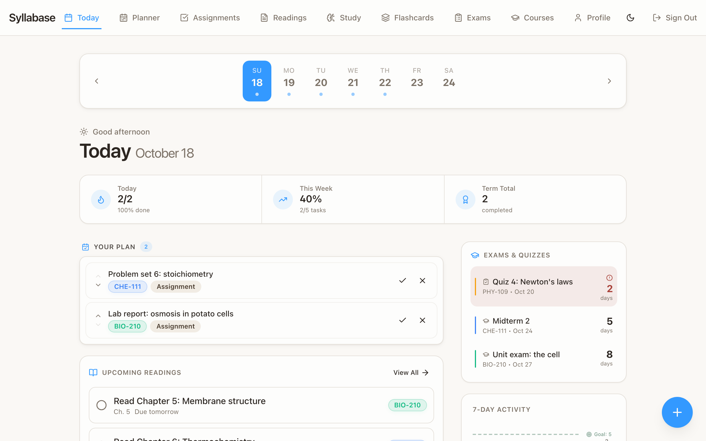
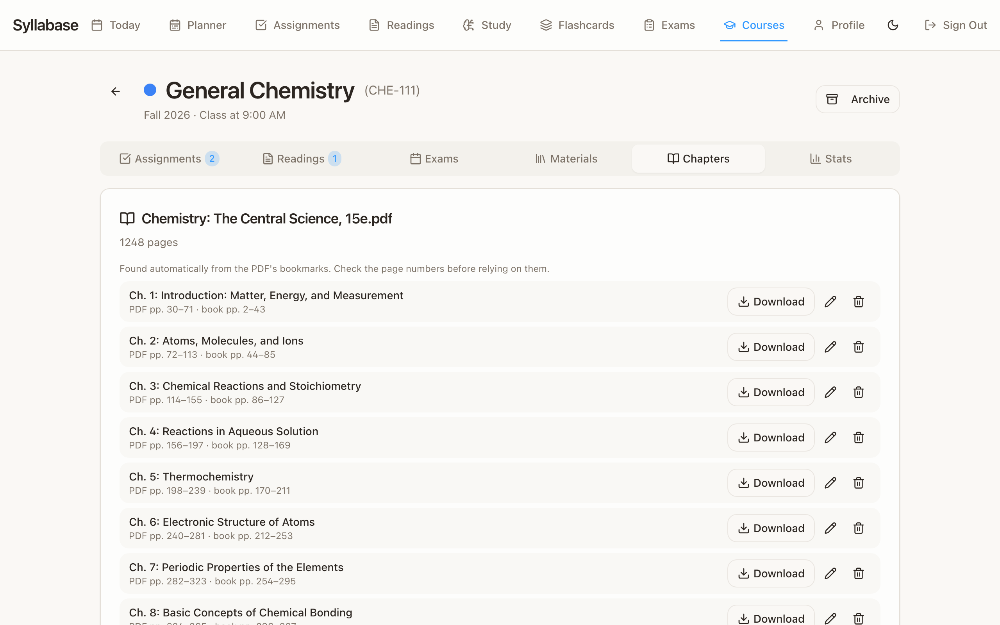
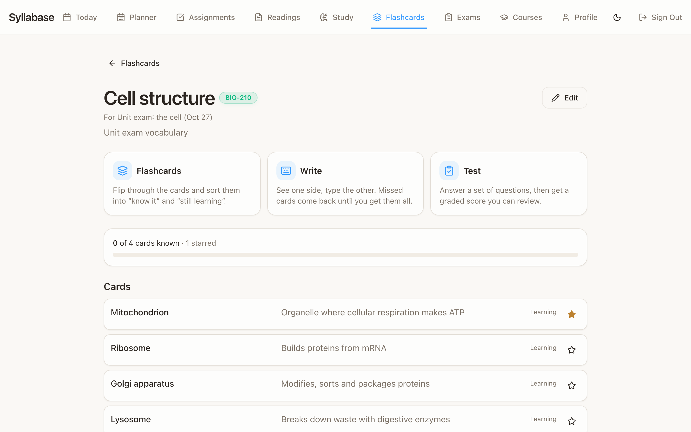
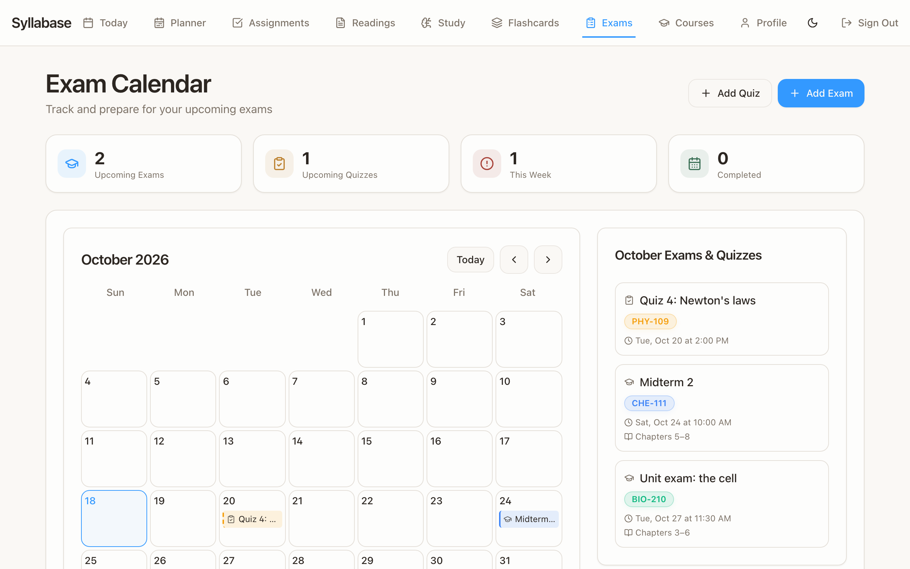
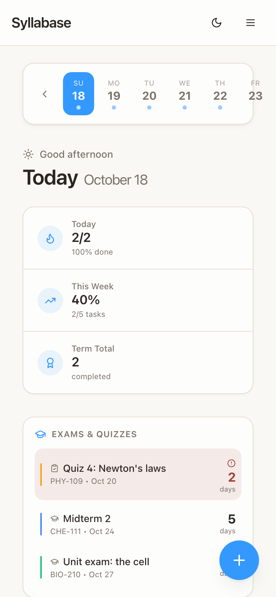

<div align="center">


# Syllabase

**A self-hosted study planner for students juggling courses, homework, labs and exams.**<br/>
Your data stays on your own server. One `docker compose up -d`, nothing to configure.

[](https://github.com/OwenWright8/syllabase/releases/latest)
[](https://github.com/OwenWright8/syllabase/actions/workflows/ci.yml)
[](https://github.com/OwenWright8/syllabase/pkgs/container/syllabase)

[](LICENSE)

[Quickstart](#quickstart) · [Features](#features) · [Settings](#optional-settings) · [Updating](#updating) · [Backups](#backups) · [Release notes](https://github.com/OwenWright8/syllabase/releases)

<picture>
  <source media="(prefers-color-scheme: dark)" srcset="docs/screenshots/today-dark.png" />
  
</picture>

</div>

## Why Syllabase

- **Everything due, in one place.** Today's plan, what's coming up, exams counting down, and how your week is going.
- **Your textbooks, by the chapter.** Upload a PDF and download just the chapter you need, found automatically from the book's bookmarks or contents page.
- **Syllabus in, readings out.** Upload a syllabus and confirm the readings it finds; each one gets a download button for its pages.
- **Study tools built in.** Flashcards with flip, write and graded test modes, linked to the exam they're for.
- **Yours to run.** Two containers, no external accounts, works on a Raspberry Pi. Installable as an app on your phone.

<table>
  <tr>
    <td width="50%"></td>
    <td width="50%"></td>
  </tr>
  <tr>
    <td align="center"><sub>Download any chapter of an uploaded textbook</sub></td>
    <td align="center"><sub>Flashcards with flip, write and test modes</sub></td>
  </tr>
  <tr>
    <td width="50%"></td>
    <td width="50%" align="center"></td>
  </tr>
  <tr>
    <td align="center"><sub>Exams and quizzes on a calendar</sub></td>
    <td align="center"><sub>Works on your phone, installable as an app</sub></td>
  </tr>
</table>

## Self-hosting

Syllabase is two containers: `db` (Postgres, extended with a couple of small init scripts GoTrue/PostgREST need — see `Dockerfile.db`), and one `app` container bundling everything else — auth, the REST API, the 5 edge functions, and the frontend, all behind an internal gateway. No external accounts or SaaS dependencies required. Images are published for both `amd64` and `arm64`, so it runs on a Raspberry Pi or other ARM server as well as a regular PC.

### Quickstart

**1.** Save this as `docker-compose.yml`:

```yaml
services:
  db:
    image: ghcr.io/owenwright8/syllabase-db:latest
    restart: unless-stopped
    environment:
      # Optional (see "Optional settings"): leave as they are for automatic setup.
      POSTGRES_PASSWORD: ${POSTGRES_PASSWORD:-}
      POSTGRES_DB: ${POSTGRES_DB:-postgres}
      JWT_EXP: ${JWT_EXP:-3600}
    volumes:
      - db-data:/var/lib/postgresql/data
      - secrets:/secrets
    healthcheck:
      test: ["CMD-SHELL", "pg_isready -U postgres"]
      interval: 5s
      timeout: 5s
      retries: 20

  app:
    image: ghcr.io/owenwright8/syllabase:latest
    restart: unless-stopped
    depends_on:
      db:
        condition: service_healthy
    environment:
      # Optional (see "Optional settings"): leave as they are for automatic setup.
      POSTGRES_PASSWORD: ${POSTGRES_PASSWORD:-}
      POSTGRES_DB: ${POSTGRES_DB:-postgres}
      JWT_SECRET: ${JWT_SECRET:-}
      JWT_EXP: ${JWT_EXP:-3600}
      ANON_KEY: ${ANON_KEY:-}
      SERVICE_ROLE_KEY: ${SERVICE_ROLE_KEY:-}
      CRON_SECRET: ${CRON_SECRET:-}
      # Course materials (uploaded textbooks and syllabi). All optional.
      DOCUMENTS: ${DOCUMENTS:-on}
      DOCUMENT_MAX_FILE_MB: ${DOCUMENT_MAX_FILE_MB:-}
      DOCUMENT_USER_QUOTA_MB: ${DOCUMENT_USER_QUOTA_MB:-}
      DOCUMENT_MAX_COUNT: ${DOCUMENT_MAX_COUNT:-}
      # "off" stops the app from checking GitHub for new releases.
      UPDATE_CHECK: ${UPDATE_CHECK:-on}
    volumes:
      - secrets:/secrets
    security_opt:
      - no-new-privileges:true
    ports:
      - "${APP_PORT:-8080}:8080"

volumes:
  db-data:
  secrets:
```

**2.** Start it:

```sh
docker compose up -d
```

**3.** Open `http://<your-server-ip>:8080` and create the first account.

That's the whole setup. There is nothing to configure: on first start it generates its own secrets (database password, signing keys) and keeps them in the `secrets` volume, and it uses whatever address you open it at, so an IP and port work as they are. (To use a different port, set `APP_PORT` or change the left-hand `8080` in `ports`.)

Anyone with the URL can create their own account and their own private data (there's no email verification since there's no SMTP server involved), so keep that in mind if you're putting this on the open internet rather than behind a VPN/private network. See [Security notes](#security-notes) below.

**Using a domain and HTTPS:** point your reverse proxy (Caddy, Traefik, nginx…) at port `8080`. There is no URL setting to change: the app follows the address it is loaded from, including behind a proxy.

**Building from source** instead of pulling the prebuilt images: clone the repo and run `docker compose up -d --build` (the repo's own `docker-compose.yml` is set up for both).

### Optional settings

None of these are required. Docker Compose reads a `.env` file next to `docker-compose.yml` automatically; [`.env.example`](.env.example) lists them, all commented out.

| Setting | What it does |
|---|---|
| `POSTGRES_PASSWORD`, `JWT_SECRET`, `CRON_SECRET`, `ANON_KEY`, `SERVICE_ROLE_KEY` | Use your own secrets instead of generated ones. |
| `APP_PORT` | The port the app is published on (default `8080`). |
| `DOCUMENTS` | `off` disables uploading textbooks/syllabi and doesn't start the OCR worker (default `on`). |
| `DOCUMENT_MAX_FILE_MB`, `DOCUMENT_USER_QUOTA_MB`, `DOCUMENT_MAX_COUNT` | Largest single upload (default 200 MB), total per user (default 1024 MB) and most documents per user (default 200). There is no limit on a PDF's page count. Sign-up is open, so these bound what any one account can store. Each also accepts `unlimited`, sensible on a private instance where you trust everyone with an account. These are only read if your compose file passes them to the `app` service, as the one above does. |
| `UPDATE_CHECK` | `off` stops the server from checking GitHub for new releases, and hides the update reminder (default `on`). See [Updating](#updating). |
| `SYLLABASE_VERSION` | Pin to a release (e.g. `v0.7.0`), or to a minor series (e.g. `0.7`, which still gets patch releases) instead of `latest`. |

### Updating

When a new release comes out, Syllabase tells you: a slim **"Syllabase v0.8.0 is available — What's new"** note appears under the navigation bar, linking to that release's notes. It can be dismissed (it comes back for the next release), and **Profile → About** always shows the version you're running and whether it's current.

To update:

```sh
docker compose pull && docker compose up -d
```

Migrations apply automatically, each in its own transaction. Read the [release notes](https://github.com/OwenWright8/syllabase/releases) first: anything you need to do will be at the top.

**How the check works, and turning it off.** Every 12 hours the `app` container makes one anonymous request to GitHub's public API for the latest release and saves the answer for the app. Nothing about your instance or its users is sent, and people's browsers never contact GitHub themselves. Set `UPDATE_CHECK=off` to stop it entirely.

**Pinning a version.** `latest` always moves to the newest release. To decide when upgrades happen, set `SYLLABASE_VERSION` in `.env` to a release such as `v0.7.0`, or to a minor series such as `0.7` to keep getting bug-fix releases automatically but not new features. (Minor-series tags are published from v0.7.0 on.)

**Coming from v0.3.x or earlier** (where you ran `./setup.sh` and edited `.env`)? Nothing needs to change: your existing compose file and `.env` keep working, and `SITE_URL` is no longer used (delete it if you like). If you switch to the new compose file above, keep your `.env` next to it: it holds your database password, and the database refuses to start rather than guess a new one.

### Backups

Your data lives in the `db-data` volume and the keys that go with it live in the `secrets` volume, so back up **both**. Uploaded textbooks and syllabi are stored in the database, so they are included.

A simple way, from the folder with your `docker-compose.yml` (volume names are prefixed with the folder's name; `docker volume ls` shows them):

```sh
docker compose stop
for v in db-data secrets; do
  docker run --rm -v "$(basename "$PWD")_$v":/data -v "$PWD":/backup alpine \
    tar czf "/backup/syllabase-$v-$(date +%F).tar.gz" -C /data .
done
docker compose start
```

To restore, recreate the volumes and extract each archive back into its volume before starting. If `secrets` is lost but `db-data` survives, the database will refuse to start (rather than silently create a password that doesn't match) and tell you what to restore.

### Security notes

- **Put it behind HTTPS.** The `app` container speaks plain HTTP on the published port. Run it behind a reverse proxy (Caddy, Traefik, nginx…) that terminates TLS. Passwords and session tokens cross the wire on every request, so don't expose the plain-HTTP port to the internet.
- **Sign-up is open.** Anyone who can reach the URL can create an account (each account only ever sees its own data). If that isn't what you want, keep the instance on a private network/VPN or restrict access at your reverse proxy.
- **Postgres is not exposed to the network.** The app talks to it over the internal compose network and its port isn't published.
- **The `secrets` volume holds every key** (database password, JWT signing secret, cron secret). Anyone who can run Docker commands on the host can read it, just as they could read a `.env` file. Treat it like one: keep it out of version control and out of backups you don't trust.
- **Sign-in attempts are rate limited** per client IP at the gateway. Behind a reverse proxy, make sure it forwards the client address in `X-Forwarded-For` (most do by default) so the limit applies per person rather than to the proxy as a whole.

### Notifications (optional)

Push notifications go through [Pushover](https://pushover.net) — each person brings their own free Pushover account and app token, configured on the Profile page. Nothing here depends on how the instance is hosted, and no notification setup is required for the app to work.

---

## Features

### 🗓 Today View
- Shows everything scheduled for the selected day, plus your ordered "plan" for the day.
- At-a-glance stats: due today, week progress, term totals.
- A 7-day activity chart and streak tracking.

### 📚 Courses & Assignments
- Create courses with short codes (e.g., `CHE-111`, `PHY-109`) and color tags.
- Assignments with type, due date/time, course, notes, and priority.
- Archive completed assignments and whole courses at the end of a term.

### 📎 Course materials
- Upload each class's textbooks (PDF) and syllabus (PDF, Word or a photo) on the course's **Materials** tab. Scans and photos are read with OCR on your own server.
- A textbook's chapters are found from its bookmarks or its printed contents page (you can correct, add or remove them), and each chapter downloads as its own small PDF, so you can grab "chapter 5" instead of the whole book. Once a textbook has been read, its course gets a **Chapters** tab listing every chapter with a Download button. Any page range can be downloaded too.
- **Find readings** on an uploaded syllabus looks for what's due when ("Read Chapter 5 by 10/18", a table of weeks, dated headings) and asks you to confirm it before anything is added. Confirmed readings appear in your readings list, each with a **Download Ch. 5 (pp. 101–130)** button when the chapter is in one of your textbooks. Readings you type in yourself get the button too, as long as they name the chapter or pages ("Read Chapter 5") and that course's textbook has been read. Readings that were due in the past are added as done. This is rule-based, not AI, so always glance over the review: unusual layouts may be missed.
- Files are stored in your database and processed by a sandboxed background worker; per-user limits apply (see `DOCUMENT_*` settings).

### 🧪 Exams, Quizzes & Study Items
- Track exams and quizzes per course.
- Study items can link to a specific exam/quiz, with priority and status.
- A dedicated Study page and Today-page widget surface what needs attention.

### 🗂 Flashcards
- Make decks of terms and definitions, optionally for a course and linked to an exam and/or a quiz (the exam's and quiz's details show their decks).
- Type cards in, or paste a list: Quizlet's export works as it is, and other separators can be chosen. Star cards, reorder them, or swap every term and definition.
- Three ways to study:
  - **Flashcards**: flip through and sort cards into "know it" and "still learning" (keyboard: Space flips, arrows move).
  - **Write**: see one side and type the other. Missed cards come back until you've got them all.
  - **Test**: answer a set of questions, then get a graded score, review each answer, count one as correct if the grading was too harsh, and retake the ones you missed. Past tests are kept.
- Everything is adjustable per deck and remembered: which side you answer with (or both, mixed), which cards (all, starred, or the ones you're still learning), shuffling, test length, and how strict the grading is (capitals, punctuation, accents, small typos, and accepting long answers that have most of the key words). Answers can list alternatives with ";" and optional words in (parentheses).

### 📖 Readings & Planner
- Track readings alongside assignments.
- A day-planner view for ordering exactly what you're working on, when.

### 👤 Accounts
- Username/password accounts. The first visit to a fresh instance creates the first account; after that it's a normal sign in / sign up screen.
- Change your password from the Profile page once logged in.

### 🔌 Homepage widget
- A read-only stats API (`widget-stats` function, API-key gated) for embedding your stats into a [Homepage](https://gethomepage.dev) dashboard or similar.

### 🌙 UI / UX
- Light/dark themes with several accent color options.
- Responsive design, installable as a PWA.

---

## Tech Stack

- **Frontend**: React + TypeScript + Vite
- **UI**: Tailwind CSS + shadcn/ui
- **Backend / DB**: Self-hosted Supabase-compatible stack (Postgres + GoTrue auth + PostgREST + Edge Functions), with nginx as the internal gateway
- **Deployment**: Docker Compose (2 containers: Postgres + one all-in-one app container)

## Development

```sh
npm ci
npm run dev        # http://localhost:8080 — point VITE_SUPABASE_URL / VITE_SUPABASE_PUBLISHABLE_KEY at a running instance
npm run test:e2e   # Playwright; needs no backend (see below)
```

The end-to-end tests (`e2e/`) drive the real UI in Chromium against an in-memory fake of the backend (`e2e/support/fakeBackend.ts`), installed by intercepting network requests — so they run with no server, database or Docker. Run `npx playwright install chromium` once first.

The README's screenshots come from the same setup, with a demo student's week: `SCREENSHOTS=1 npx playwright test e2e/screenshots.spec.ts` regenerates everything in `docs/screenshots/`.

### Releasing

Push a tag like `v0.7.0`. The release workflow creates the GitHub Release with notes grouped by PR label (see `.github/release.yml`: label PRs `feature`, `fix`, `breaking`…) and publishes both images as `:v0.7.0`, `:0.7` and `:latest`. A pre-release tag (`v0.8.0-rc.1`) is published under its own tag only. Running instances notice the new release within 12 hours.

## License

[MIT](LICENSE) © 2026 Owen Wright
